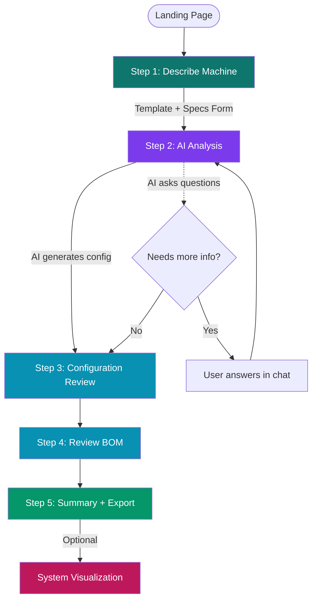
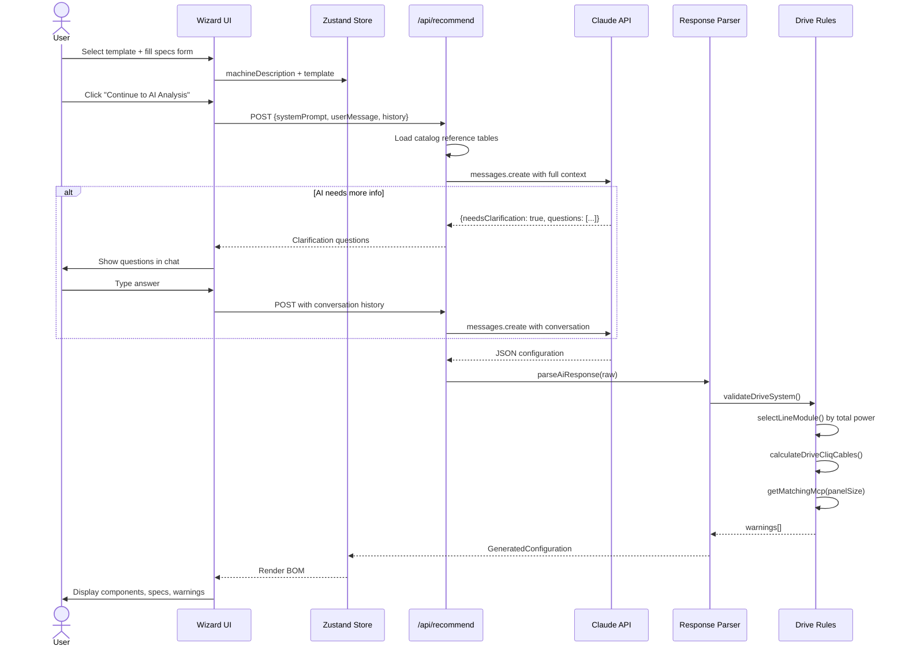
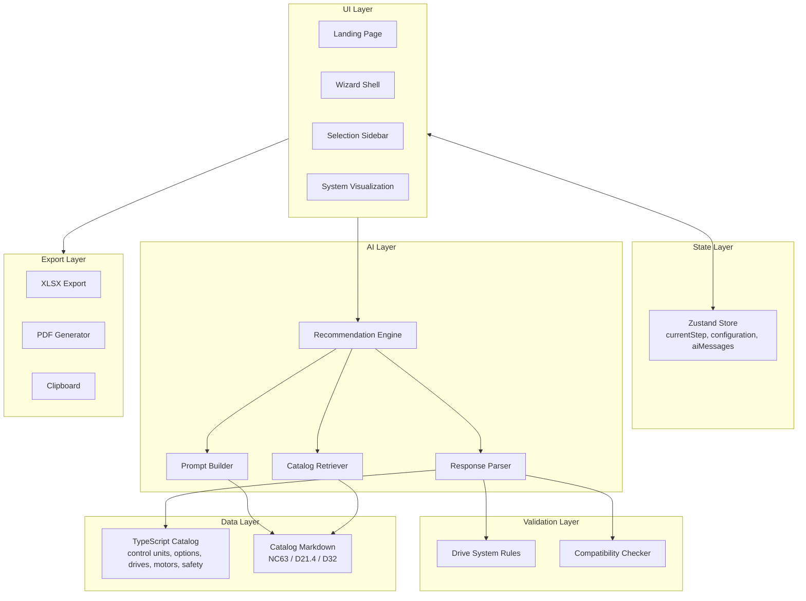
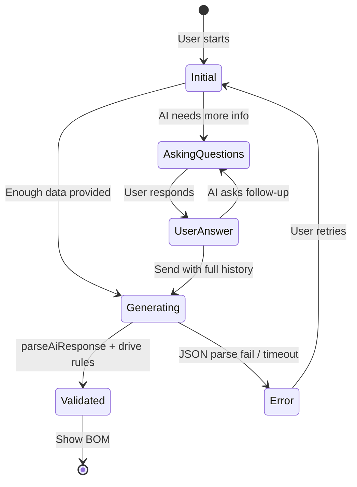
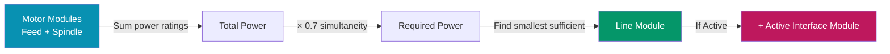
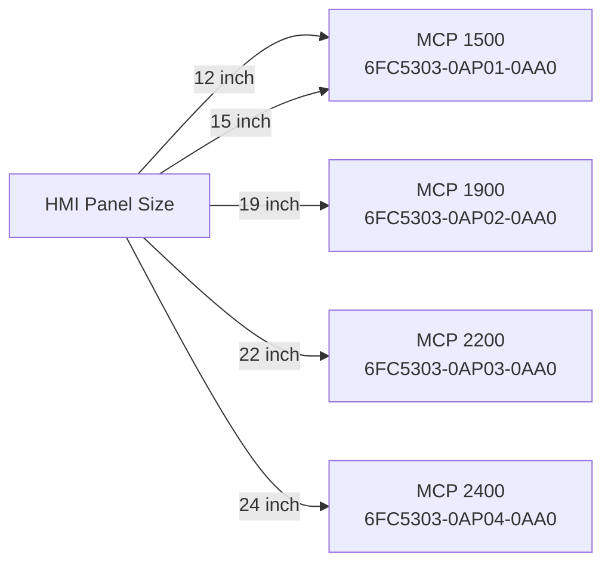
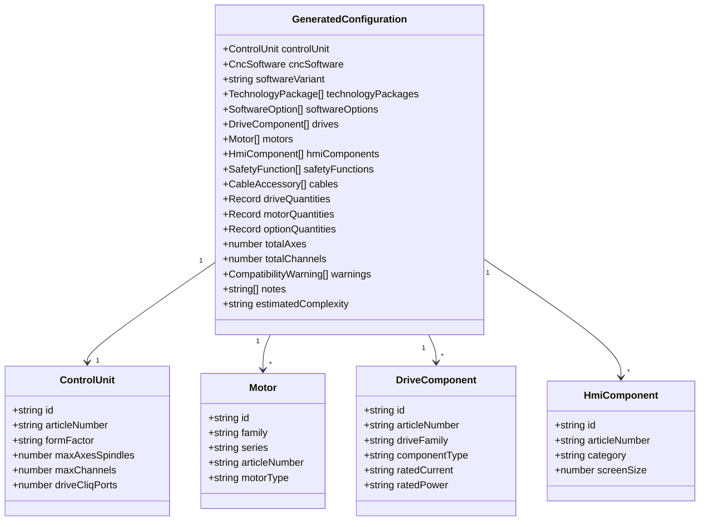

# Architecture

This document explains how the SINUMERIK ONE AI Configurator works internally — data flow, AI integration, validation rules, and key design decisions.

## High-Level Overview

The app is a **Next.js wizard** that collects machine requirements, sends them to **Claude (Anthropic API)** along with curated SINUMERIK catalog data, receives a structured JSON configuration, validates it against drive sizing rules, and renders a complete bill of materials (BOM).

```mermaid
flowchart LR
    User[User] -->|Machine specs| UI[Next.js Wizard]
    UI -->|API call| Route[/api/recommend]
    Route -->|System prompt + catalog tables| Claude[Claude Sonnet 4]
    Claude -->|JSON response| Parser[Response Parser]
    Parser -->|Validated config| Rules[Drive System Rules]
    Rules -->|Final BOM| UI
    UI -->|Export| Out[Copy / Excel / PDF]
```

## The 5-Step Wizard Flow



## Data Flow: From User Input to BOM



## Architectural Layers



## AI Integration Details

### System Prompt Structure

The system prompt sent to Claude is assembled from two parts:

1. **Base prompt** (`lib/ai/prompt-builder.ts`, ~7KB / ~1800 tokens) — contains:
   - SINUMERIK ONE base scope rules (3 axes included, 1 channel)
   - Control unit specs (PPU 1740, NCU 1740/1750/1760)
   - Safety rules (S60 only for extended safety)
   - Technology packages (S41/S42/S43)
   - Key software options
   - Mandatory clarification rules
   - Output JSON schema

2. **Catalog reference tables** (`lib/ai/catalog-retriever.ts`, ~5KB / ~1200 tokens) — contains:
   - 1FT7 motor selection tables (shaft height, torque, article number, matching Motor Module)
   - 1PH8 spindle motor tables (power, speed, article number, matching Motor Module)
   - S120 Line Module options with article numbers
   - 1FT7 forced ventilation options for heavy-duty machines

Total system prompt: ~3000 tokens.

### Conversation Flow



### JSON Response Extraction

The parser tries **3 strategies** to extract JSON from the AI response (Claude sometimes wraps output in markdown):

```typescript
// 1. Try markdown code block: ```json ... ```
const codeBlockMatch = text.match(/```(?:json)?\s*\n?([\s\S]*?)\n?```/);

// 2. Try raw JSON object
const jsonMatch = text.match(/\{[\s\S]*\}/);

// 3. Try the entire response as JSON
JSON.parse(text.trim());
```

## Drive System Sizing Rules

The validation layer applies engineering rules to catch AI errors:

### Line Module Sizing



Example: 3×9A feed (4.8kW each) + 1×30A spindle (16kW) = 30.4kW × 0.7 = 21.3kW → **Smart 36kW (6SL3130-6TE23-6AA3)**

### DRIVE-CLiQ Cable Count

Topology: `NCU → Line Module → Motor Module 1 → Motor Module 2 → ...`

```
Cable count = Total Motor Modules + 1
             (the +1 is NCU to Line Module)
```

For a 4-module system (3 feed + 1 spindle): **5 DRIVE-CLiQ cables** (not 6 or 7).

### MCP-Panel Size Matching



### NCU DRIVE-CLiQ Port Validation

- PPU 1740 / NCU 1740: 4 ports
- NCU 1750 / NCU 1760: 6 ports
- Max 6 Motor Modules per daisy-chain
- If exceeded → warn user to add NX extension module

## Component Data Model



## SINUMERIK ONE System Topology

What the app configures — the actual hardware architecture:

```mermaid
flowchart TB
    subgraph Operator[Operator Level]
        Panel[HMI Panel<br/>ITC1500/ITC1900/ITC2200]
        MCP[Machine Control Panel<br/>MCP 1500/1900/2200/2400]
        HW[Handwheel]
    end

    subgraph Control[Control Level]
        NCU[NCU 1740/1750/1760<br/>or PPU 1740]
    end

    subgraph Drive[Drive Level - S120 Booksize]
        LM[Line Module<br/>Smart or Active]
        MM1[Motor Module 1<br/>Feed X]
        MM2[Motor Module 2<br/>Feed Y]
        MM3[Motor Module 3<br/>Feed Z]
        MMS[Motor Module<br/>Spindle]
    end

    subgraph Motors[Motor Level - SIMOTICS]
        MX[1FT7 Servo X]
        MY[1FT7 Servo Y]
        MZ[1FT7 Servo Z]
        MS[1PH8 Spindle]
    end

    Panel -.->|PROFINET| NCU
    MCP -.->|PROFINET| NCU
    HW -.->|X120| MCP

    NCU ==>|DRIVE-CLiQ| LM
    LM ==>|DC Bus| MM1
    LM ==>|DC Bus| MM2
    LM ==>|DC Bus| MM3
    LM ==>|DC Bus| MMS
    LM --.->|DRIVE-CLiQ| MM1
    MM1 --.->|DRIVE-CLiQ| MM2
    MM2 --.->|DRIVE-CLiQ| MM3
    MM3 --.->|DRIVE-CLiQ| MMS

    MM1 -->|Power + Encoder| MX
    MM2 -->|Power + Encoder| MY
    MM3 -->|Power + Encoder| MZ
    MMS -->|Power + Encoder| MS

    style Operator fill:#faf5ff
    style Control fill:#ecfeff
    style Drive fill:#eff6ff
    style Motors fill:#ecfdf5
```

## Key Design Decisions

### Why use Claude API instead of local rules?

The SINUMERIK catalog contains **millions of motor/drive combinations** across shaft heights, torques, speeds, encoders, brakes, connectors, IP ratings. Hardcoding every variant is impossible. Claude can:
- Parse natural language machine descriptions
- Match mechanical specs to motor torque/speed requirements
- Choose appropriate converter size, line module, and cable cross-section
- Explain decisions in plain language

### Why embed compact tables instead of RAG on full catalogs?

Early versions tried chunking the 14MB of catalog markdown. Problems:
- Slow indexing on each request
- Unpredictable chunk selection
- Token budget overruns

The current approach embeds ~20 selection tables (1FT7, 1PH8, Line Modules, Motor Modules) — about 1200 tokens — directly into the prompt. These tables cover 95% of typical configurations.

### Why validate AI output with rules?

Claude occasionally makes sizing errors (e.g., undersized Line Module, wrong DRIVE-CLiQ cable count). The rules layer catches these:
- `selectLineModule()` — recomputes required power
- `calculateDriveCliqCables()` — deterministic topology
- `getMatchingMcp()` — enforces panel size match
- `checkDriveCliqPorts()` — flags NX extension need

Warnings are shown to the user; critical issues auto-corrected.

### Why a specs form instead of relying on AI questions?

Experiments showed Claude inconsistently asks clarifying questions. A structured form guarantees mechanical data (axis travels, moving mass, spindle power) is always provided up front.

## Request/Response Example

### Request (to `/api/recommend`)

```json
{
  "systemPrompt": "You are a SINUMERIK ONE expert...",
  "userMessage": "5-axis milling machine. Axes: X Y Z A C.\n\nMechanical Specifications:\nMachine size: Large machine (500-2000kg/axis)\nAxis travel: 2000 × 1500 × 800 mm\nMoving mass per axis: 800 kg\nRapid traverse: 40 m/min\nSpindle power: 22 kW\nSpindle max speed: 18000 rpm\nPrimary material: steel",
  "conversationHistory": []
}
```

### Response (from Claude → parsed)

```json
{
  "controlUnit": { "id": "NCU_1750", "reason": "5-axis simultaneous requires NCU 1750+ for Dynamics 5 Axis (S43)" },
  "cncSoftware": { "variant": "full_scope", "swVersion": "6.25 SP1" },
  "technologyPackages": [{ "id": "S43", "reason": "..." }],
  "additionalOptions": [
    { "orderCode": "A03", "name": "3 additional axes/spindles", "quantity": 3, "reason": "..." }
  ],
  "drives": {
    "mainFamily": "S120_booksize",
    "feedMotorModules": 5,
    "spindleMotorModules": 1,
    "lineModule": "Active Line Module 55kW",
    "lineModuleArticle": "6SL3130-7TE25-5AA3",
    "feedMotorModuleArticle": "6SL3120-1TE22-4AD0",
    "spindleMotorModuleArticle": "6SL3120-1TE24-5AC0"
  },
  "motors": {
    "feedMotors": "SIMOTICS S-1FT7",
    "feedMotorArticle": "1FT7084-5AF71-1DA1",
    "feedMotorShaftHeight": 80,
    "spindleMotors": "SIMOTICS M-1PH8",
    "spindleMotorArticle": "1PH8167-1FF10-0LA1",
    "spindleMotorShaftHeight": 160
  },
  "hmi": { "type": "thin_client", "model": "ITC1900 V3 19\"" },
  "mcp": { "articleNumber": "6FC5303-0AP02-0AA0", "model": "MCP 1900" },
  "safety": { "options": ["S60", "S61"] },
  "totalAxes": 6,
  "totalChannels": 1,
  "notes": ["..."],
  "estimatedComplexity": "advanced"
}
```

## Performance Characteristics

| Operation | Typical Duration |
|---|---|
| Initial AI call (with full catalog context) | 8-15 seconds |
| Follow-up AI call (with conversation history) | 5-10 seconds |
| Response parsing + validation | <50ms |
| BOM rendering | <100ms |
| Excel export | <500ms |
| PDF export | <1s |

## File Reference

| File | Purpose |
|---|---|
| `src/app/api/recommend/route.ts` | Server-side API endpoint, calls Anthropic |
| `src/lib/ai/prompt-builder.ts` | Base system prompt |
| `src/lib/ai/catalog-retriever.ts` | Compact catalog tables |
| `src/lib/ai/recommendation-engine.ts` | Client-side fetch wrapper |
| `src/lib/ai/response-parser.ts` | AI JSON → typed config |
| `src/lib/validation/drive-system-rules.ts` | Sizing rules + warnings |
| `src/store/configurator-store.ts` | Zustand state |
| `src/components/configurator/wizard-shell.tsx` | 5-step wizard container |
| `src/components/configurator/ai-analysis-step.tsx` | AI conversation UI |
| `src/components/configurator/system-visualization.tsx` | Block diagram page |
