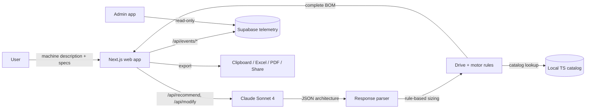
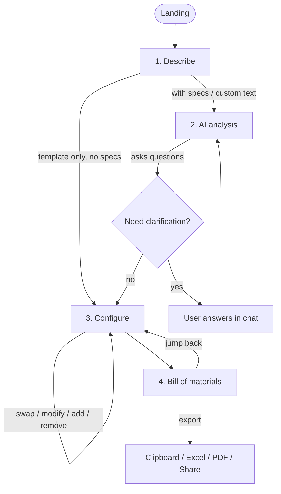
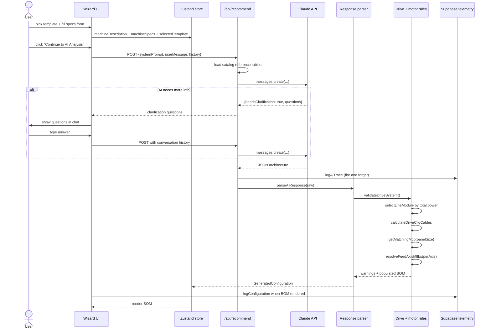
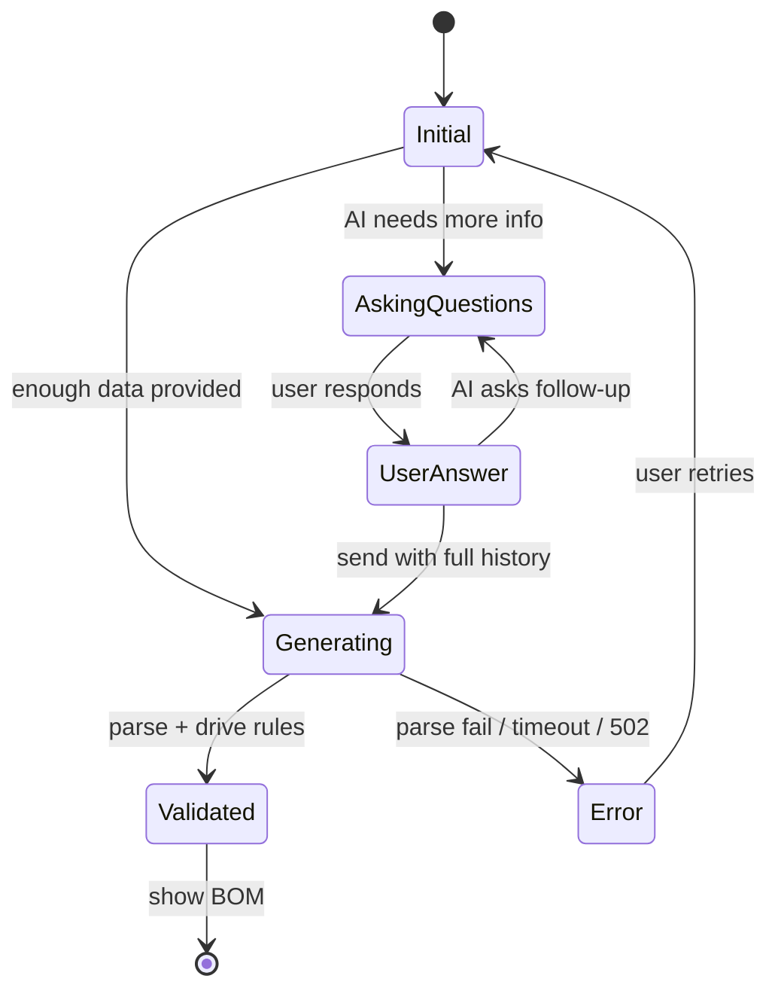
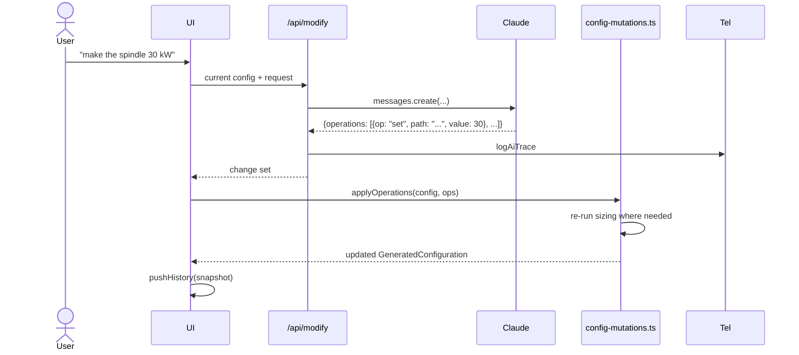
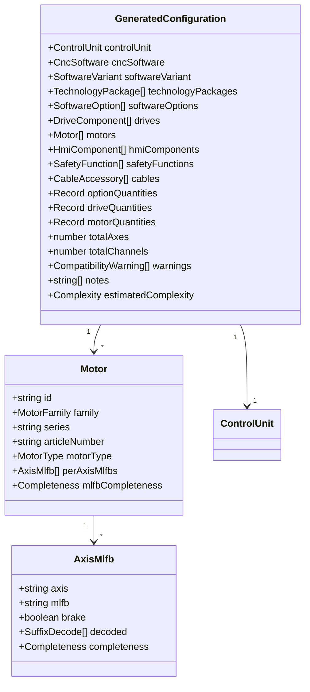
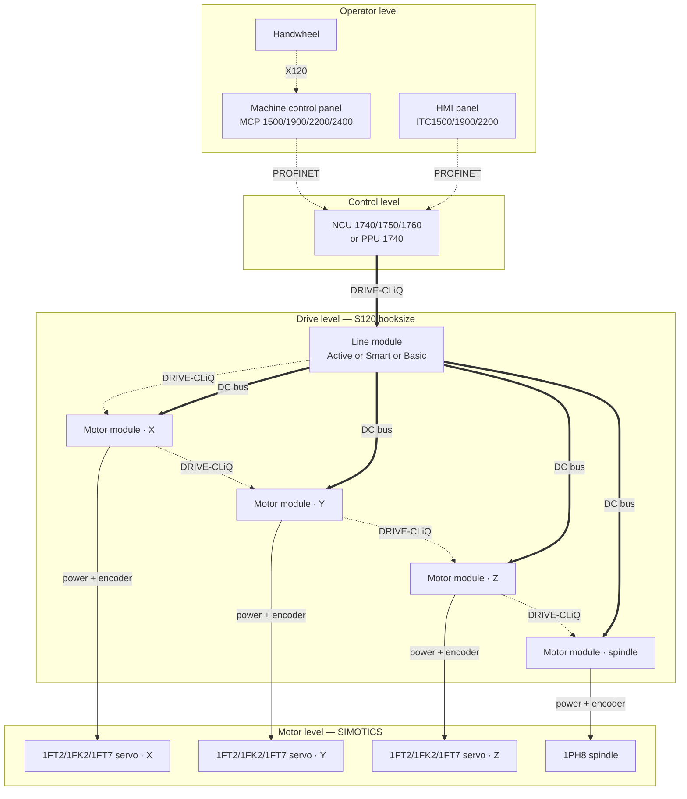

# Architecture

The internals of the SINUMERIK ONE Configurator — repo layout, data
flow, AI integration, MLFB compositional grammar, drive-system rules,
telemetry, and the admin dashboard.

> **Audience** — developers and contributors. End-user material lives
> in [USER_GUIDE.md](USER_GUIDE.md). Telemetry-specific operational
> notes (env vars, migrations, Vercel projects) live in
> [TELEMETRY.md](TELEMETRY.md).

---

## 1. The big picture

> Interactive versions of this picture live in `docs/diagrams/`:
> `how-it-works.html` (non-technical) and `technical-architecture.html`
> (developer view). They are generated with
> [archify](https://github.com/tt-a1i/archify) from the
> `*.architecture.json` files in the same folder — edit the JSON, then run
> `node bin/archify.mjs deliver architecture <json> <html> --quality showcase`
> from an archify checkout.



**Two halves of the design:**

- **The AI does only one job** — read the description and pick the
  high-level *architecture*: control unit, technology packages,
  drive family, HMI panel, safety level. It is explicitly forbidden
  in its prompt from inventing motor or drive part numbers.
- **Rule-based code in the app**, using a versioned local Siemens
  catalog, fills in every actual MLFB. Sizing math is deterministic;
  catalog data is the single source of truth.

This split is what keeps the BOM auditable. Every article number can
be traced to a catalog file shipped with the repo (NC63, D21.4, D32).

---

## 2. Repo layout

This repo is an npm workspaces monorepo:

```text
apps/
├── web/                   public configurator (deploys as the main site)
└── admin/                 private telemetry dashboard (separate Vercel project)
packages/
└── telemetry/             shared Supabase server client + types + redaction
docs/                      this folder
supabase/                  SQL migrations
```

Run scripts from the repo root:

```bash
npm install                # installs all workspaces
npm run dev                # apps/web on :3000
npm run dev:admin          # apps/admin on :3001
npm run build              # apps/web only
npm run build:admin        # apps/admin only
npm run build:all          # both
```

Vercel auto-detects npm workspaces — the install runs once at the
repo root, then each Vercel project sets its own `Root Directory`
(`apps/web` or `apps/admin`) and runs its own build.

---

## 3. The 4-step wizard



The step indicator at the top lets you click any finished step to
jump back. Wizard state is held in a Zustand store
([`apps/web/src/store/configurator-store.ts`](../apps/web/src/store/configurator-store.ts)).

---

## 4. Detailed data flow



---

## 5. AI integration

### What the AI receives

A single system prompt assembled in
[`prompt-builder.ts`](../apps/web/src/lib/ai/prompt-builder.ts) plus
catalog reference tables from
[`catalog-retriever.ts`](../apps/web/src/lib/ai/catalog-retriever.ts).

| Section                        | Approx. tokens |
| ------------------------------ | -------------- |
| Base prompt (rules + schema)   | ~1800          |
| Catalog selection tables       | ~1200          |
| **Total system prompt**        | **~3000**      |

The catalog tables embed compact selection data for the verified
motor families (1FT2, 1FK2, 1FT7, 1FK7, 1PH8), the SINAMICS S120
Line Modules, and the standard HMI/MCP combinations. About 95% of
real configurations are covered without RAG over the full 14 MB of
catalog markdown.

### What the AI returns

A small JSON object — short codes, no MLFBs:

```json
{
  "controlUnit": { "id": "NCU_1750" },
  "cncSoftware": { "variant": "full_scope", "swVersion": "6.25 SP1" },
  "technologyPackages": [{ "id": "S43" }],
  "additionalOptions": [{ "orderCode": "A03", "quantity": 2 }],
  "driveArchitecture": {
    "family": "S120_booksize",
    "feedAxisCount": 5,
    "spindleCount": 1,
    "preferActiveLineModule": true,
    "highSpeedSpindle": true
  },
  "hmi": { "type": "thin_client", "panelSizeInch": 19 },
  "safety": { "options": ["S60", "S61"] },
  "userPreferences": {
    "motorFamily": "1FT7",
    "axisNames": ["X", "Y", "Z", "A", "C"],
    "brakeAxes": ["Z", "A"]
  },
  "totalAxes": 6,
  "totalChannels": 1
}
```

`userPreferences` is what threads the user's per-axis brake choice
through to the per-axis MLFB resolver.

### Template-only fast path

If the user only picked a template and filled nothing else, the AI
is **skipped entirely** and a built-in architecture for that
template is used
([`template-architectures.ts`](../apps/web/src/lib/ai/template-architectures.ts)).
Faster and cheaper. As soon as any spec or note is provided, the
call routes through the AI.

### JSON extraction

The AI sometimes wraps its JSON in markdown fences or chats around
it. The extractor in
[`response-parser.ts`](../apps/web/src/lib/ai/response-parser.ts)
tries multiple strategies:

1. ```` ```json ... ``` ```` fenced block.
2. Largest balanced `{ … }` substring.
3. The whole response as JSON.

If the AI's `stop_reason` is `max_tokens`, the route returns
`502 ai_response_truncated` rather than parsing a partial blob.

### Conversation state



---

## 6. Catalog + MLFB compositional grammar

This is the part that keeps the BOM honest.

### Why compositional, not hardcoded

Hardcoding "189 verified MLFBs" sounds like 189 orderable codes. In
reality each catalog motor *trunk* (e.g. `1FT2104-4AF`) composes
with verified suffix combinations (encoder + brake + IP class +
shaft form) into roughly 30 distinct orderable MLFBs. The
configurator stores **trunks + slot grammars**:

```text
189 catalog trunks  ×  ~30 verified suffix combinations per trunk
= ~5,300 distinct orderable MLFBs the configurator can compose,
all character-traceable to a catalog page.
```

### Per-family completeness flags

`MotorOptionModel.completeness ∈ {"verified" | "partial" | "trunk-only"}`.

| Family                 | Completeness | Source page                          |
| ---------------------- | ------------ | ------------------------------------ |
| 1FT2                   | verified     | D21.4 page 8.1/55                    |
| 1FK2                   | verified     | D32 page 1/12                        |
| 1FN3                   | verified     | D21.4 page 8.3/19                    |
| 1FT7, 1PH8             | verified     | D21.4                                |
| 1FK7                   | verified     | D21.4 (2017 ed. pages 8/36-8/37)     |
| 1PH3, 1FE1, 1FE2, 1FW6 | trunk-only   | layout not catalog-verifiable yet    |

Trunk-only families render their catalog trunk in the BOM with a
yellow "Trunk-only" badge and a note: *"Encoder, brake, shaft, and
IP-class characters are assigned at order time by your Siemens
partner."* The configurator never invents a suffix it cannot prove.

### Per-axis MLFB resolution

When the user provides per-axis brake preferences (in
`userPreferences.brakeAxes`),
[`per-axis.ts`](../apps/web/src/lib/mlfb/per-axis.ts) renders one
fully-resolved MLFB per axis, with a leader-line decoder under the
motor card showing what each suffix character means.

### MOTOR_SPECS storage convention

Articles in `MOTOR_SPECS` are stored as catalog trunks (e.g.
`1FT2206-4AF`, `1FK2103-2AG`) — a single hyphen, no suffix. Articles
with two or more hyphens (`1FT7034-5AK71-1DA1`,
`1PH8133-1FF10-0LA1`) already carry a 4-char suffix that is preserved
verbatim. The
[`getBaseMlfb()`](../apps/web/src/lib/mlfb/per-axis.ts) helper only
strips trailing 4-char segments matching `/^[0-9][A-Z]+[0-9]$/` AND
requires ≥ 2 hyphens. This stops accidental truncation of
catalog-base segments like `-4AF`.

---

## 7. Drive-system sizing rules

The validation layer in
[`drive-system-rules.ts`](../apps/web/src/lib/validation/drive-system-rules.ts)
applies engineering rules so the AI never short-circuits sizing.

### Selection order (the rule everything follows)

```text
spec / 808D list ──► MOTORS ──► DRIVES ──► LINE MODULE ──► CABLES ──► licences, warnings
                     (sized)   (catalog     (sum of        (from motor
                                pairing)     modules)       + drive set)
```

Nothing downstream is copied from the AI answer, from a default, or from
an old BOM row when the upstream item is known:

- the converter for a motor is the one `MOTOR_SPECS` pairs with it
  (1FT7 → booksize Motor Module, 1FK2 → S210, 1FL2 → S200); the drive
  family label follows that pairing, not the AI's `driveArchitecture`;
- the Line Module is sized from the resulting Motor Modules and dropped
  when every converter has its own infeed;
- cables are rebuilt from the motors that exist (quantity, shaft height →
  cross-section, braked axes → brake cables) and from the drive line-up
  (DRIVE-CLiQ devices, OCC vs booksize vs S200 topology);
- the same order is re-run after every manual change in
  [`config-mutations.ts`](../apps/web/src/lib/ai/config-mutations.ts):
  a motor swap re-pairs the converter, re-selects the 828D Combi from the
  motor currents (or falls back to booksize + Line Module + NX), rebuilds
  the per-axis MLFBs from the machine's axis layout and regenerates the
  cables; a drive swap re-sizes the Line Module and the cables; a control
  unit swap goes through the catalog for every family and re-matches the
  MCP; `setAxisCounts` (also used by the AI modify path) re-derives
  quantities, per-axis codes, drives, NX, axis licences and cables from a
  new axis count;
- accessories follow the chosen set too: the MCP matches the operator
  panel that was actually selected, PROFINET cords are counted from the
  PROFINET devices in the HMI set.

The 808D → 828D Smart converter (§16) follows the same order in three
phases: motors from the 1FL6 / 1PH1 rows, S200 drives from those motors,
cables and PROFINET cords from the motors and drive count. The 808D cable
rows only contribute lengths. `flow.test.ts` and `engine.test.ts` pin this.

### Line module sizing

```text
Sum motor module rated power × 0.7 simultaneity factor
→ pick smallest Line Module that handles the load
→ Active vs Smart vs Basic depends on AI flag / user request
```

Example: `3 × 9A feed (4.8 kW each) + 1 × 30A spindle (16 kW) →
30.4 kW × 0.7 = 21.3 kW → Smart 36 kW (6SL3130-6TE23-6AA3)`.

### DRIVE-CLiQ topology

```text
NCU → Line Module → Motor Module 1 → Motor Module 2 → …
Cable count = Total Motor Modules + 1   (the +1 is NCU → Line Module)
```

For a 4-module system (3 feed + 1 spindle): **5 DRIVE-CLiQ cables**.

### NCU DRIVE-CLiQ port validation

| Control unit          | Ports |
| --------------------- | ----- |
| PPU 1740 / NCU 1740   | 4     |
| NCU 1750 / NCU 1760   | 6     |

Max 6 Motor Modules per daisy-chain. If exceeded → warn user to add
NX extension module.

### MCP / panel matching

| Panel size | MCP article                     |
| ---------- | ------------------------------- |
| 12-15"     | MCP 1500 (`6FC5303-0AP01-0AA0`) |
| 19"        | MCP 1900 (`6FC5303-0AP02-0AA0`) |
| 22"        | MCP 2200 (`6FC5303-0AP03-0AA0`) |
| 24"        | MCP 2400 (`6FC5303-0AP04-0AA0`) |

### Cables

Cable count is derived from the motors that exist and the drive
line-up (`driveCliqDeviceCount` — a Combi Power Module is one DRIVE-CLiQ
device, not one per axis); cable cross-section from the selected motor's
shaft height (MOTION-CONNECT tables are keyed by motor frame); brake
cables from the axes that carry a brake; cable length from the user's
*Cable length* spec input (default 10 m). When the user's spec is wrong
(e.g. they ask 7 m but the BOM shows 10 m) it usually means the
parser passed the form value instead of the merged
`sizingSpecs.cableLengthMeters` — the merge happens in
[`response-parser.ts`](../apps/web/src/lib/ai/response-parser.ts).

---

## 8. Modify-on-natural-language



The history panel snapshots every change. Reverting picks any prior
snapshot back into the store.

---

## 9. Telemetry pipeline

Three Supabase tables, all written via the service-role key from the
server-only telemetry helpers in
[`packages/telemetry/src/server.ts`](../packages/telemetry/src/server.ts).
Tables have RLS on, no anon policies — leaked anon keys cannot read
or write telemetry.

| Table            | One row per…                                                          |
| ---------------- | --------------------------------------------------------------------- |
| `ai_traces`      | every call to `/api/recommend` and `/api/modify`                      |
| `configurations` | every distinct BOM the user lands on                                  |
| `user_actions`   | swap / export / journey-start / share / save events                   |

A `sessions_overview` SQL view aggregates by `session_id` for the
admin dashboard list page.

### Why the routes are `/api/events/*`, not `/api/log/*`

Earlier versions used `/api/log/configuration` etc. EasyPrivacy and
similar ad-blocker filter lists block any URL containing `/log/`,
`/track/`, `/telemetry/`. The fetch failed at the network layer, the
catch swallowed the error, and nothing reached Supabase — so a user
on a different PC with uBlock installed never appeared in the admin
dashboard while the developer's PC did. Routes are now under the
neutral `/api/events/*` path.

The full operational rundown — env vars, migration, Vercel project
setup, adding new event kinds — is in
[TELEMETRY.md](TELEMETRY.md).

---

## 10. Admin dashboard

A separate Next.js app in `apps/admin/`. Single-token auth (cookie
holds the token, `httpOnly + sameSite=lax + secure-in-prod`).

| Route             | What it shows                                              |
| ----------------- | ---------------------------------------------------------- |
| `/login`          | password gate                                              |
| `/`               | sessions list with a top-line stats strip                  |
| `/sessions/[id]`  | full timeline grouped by AI turn                           |
| `/traces/[id]`    | one AI trace with prompt, raw response, parsed JSON        |

The stats strip on `/` aggregates the visible cohort: total AI
calls (build vs. modify), median per-call latency, tokens out + in,
positive-feedback ratio, error count + error rate. Tone shifts from
neutral to good/bad based on the underlying ratio so problems jump
out without reading every cell.

Each session row leads with relative time ("2h ago") above the
exact timestamp and surfaces *modify / 👎 / error* tags directly
under the session id so reviewers can scan for sessions worth
opening.

---

## 11. PDF export rationale page

The exported PDF
([`pdf-generator.ts`](../apps/web/src/lib/export/pdf-generator.ts))
includes a second-page **Configuration rationale** composed
deterministically from configuration data — never AI-generated:

1. **Configuration overview** — narrative paragraph (machine type,
   axes/channels, sized-for hints, complexity tier).
2. **Original requirement** — verbatim quote of the user's
   description.
3. **Input parameter table** — every spec value the user entered.
4. **Architecture decisions** — control unit + CNC software with
   short factual rationale (form-factor, capacity vs. usage,
   software variant scope).
5. **Selected packages & software options** — every tech package
   and option with the *Selected for* column pulled from the catalog
   description, plus order code and article number.
6. **Drive & motor rationale** — one-liner per drive component and
   motor (Active/Smart/Basic line module distinction, async vs
   sync spindle).
7. **Per-axis MLFB breakdown** — each axis with its full MLFB and
   suffix decoder.
8. **Warnings + Disclaimer**.

Every section calls `ensureSpace()` before rendering so large BOMs
no longer overflow the page. Notes wrap via `splitTextToSize`.

---

## 12. Component data model



Defined in
[`apps/web/src/types/catalog.ts`](../apps/web/src/types/catalog.ts).

---

## 13. SINUMERIK ONE topology — what we configure



---

## 14. Performance characteristics

| Operation                                       | Typical duration |
| ----------------------------------------------- | ---------------- |
| Initial AI call (with full catalog context)     | 8 - 15 s         |
| Follow-up AI call (with conversation history)   | 5 - 10 s         |
| AI modify call                                  | 4 - 8 s          |
| Response parsing + validation                   | < 50 ms          |
| BOM rendering                                   | < 100 ms         |
| Excel export                                    | < 500 ms         |
| PDF export (with rationale page)                | < 1 s            |
| Telemetry POST (`/api/events/*`)                | < 200 ms         |

`max_tokens` for AI calls: **16384** for `/api/recommend`, **8192**
for `/api/modify`. Exceeding either returns
`502 ai_response_truncated`.

---

## 15. Control-system families (ONE · 828D · 828D Smart)

`ControlSystemFamily` threads through the store (`controlFamily`, may be
`"auto"`), the AI request (`controlSystem` in the JSON, decision guide in
the prompt when `auto`), the parser and the catalog:

| Concern | SINUMERIK ONE | 828D | 828D Smart |
|---|---|---|---|
| Data | `control-units.ts`, `cnc-software.ts`, `software-options.ts`, `hmi-components.ts`, `drives.ts` | `*-828d.ts` (NC 82 2025 + ch.2 09/2026) | same files, units `PPU_26x_5` |
| Control unit default | NCU 1740 / 1750 by axes | PPU 271.5 (H, milling) / 270.5 (V, turning) / 290.5 (15.6") | PPU 261.5 / 260.5 |
| Software | export / full scope, version | SD card SW 28x by technology | SD card SW 24x by technology |
| Axis licences | A0n for axes beyond 3 | 0AC20 × (axes − 3 or 4 for milling) | same, max 5 axes |
| Drives | S120 booksize (+ S210) | S120 Combi (`selectCombi`) with mandatory line reactor, booksize fallback, NX10.3/15.3 > 6 axes | S200 / S200 Spindle, no line module |
| Motors | 1FT2/1FK2/1FT7/1FK7, 1PH8 | same S120 families | 1FL2 (D 37.1) + 1PH3 Pro (Table 3-2) |
| Cables | `selectCables` | `selectCables` | `selectCablesS200` (MC350, MC500 raw, PN cords) |
| Safety | S60/S61/K0x | 0AC50 per axis + TM54F note | not available (warning) |

Motor selection is gated by `platformsForFamily()` so S200 motors never
appear on ONE and vice versa. `catalog-bundle.ts` merges all families for
the parser; the option dialog and swap dialog filter by the configuration's
family. Tests: `apps/web/src/lib/ai/family.test.ts`.

---

## 16. 808D → 828D Smart converter

A second, AI-free tool under `/convert`. It re-selects a SINUMERIK
808D ADVANCED bill of materials from the 828D Smart catalogue.

```mermaid
flowchart LR
    In[Paste / xlsx / csv] --> P[parser.ts]
    In -->|messy text| AI["/api/convert/parse (Claude reads rows only)"]
    AI --> P
    P -->|InputRow[]| E[engine.ts convert()]
    C[(catalog.ts — PDF-sourced tables)] --> E
    E -->|ResultLine[] + notes| UI[components/converter/*]
    UI --> X[Excel / TSV export]
```

| Module                                     | Responsibility                                                   |
| ------------------------------------------ | ---------------------------------------------------------------- |
| `src/lib/convert-808d/catalog.ts`          | Every 828D Smart article the engine may select, with its source  |
| `src/lib/convert-808d/parser.ts`           | Cells → `InputRow` (MLFB shape detection, O→0 repair, qty forms) |
| `src/lib/convert-808d/engine.ts`           | 808D row → 828D Smart lines + configuration-level notes          |
| `src/lib/convert-808d/export.ts`           | xlsx workbook, TSV, input template                               |
| `src/lib/convert-808d/catalog-rows.ts`     | Flattened rule base for the on-page catalogue table              |
| `src/store/converter-store.ts`             | Zustand store, localStorage persistence, first-run example       |
| `src/components/converter/*`               | Page UI (input rail, summary, chips, result card, catalogue)     |
| `src/app/api/convert/parse/route.ts`       | Optional AI reader — returns rows only, never products           |

Mapping rules worth knowing:

- **PPU** → 828D Smart PPU 261.5 (horizontal) or 260.5 (vertical) plus
  the milling or turning SD card. Technology is read from the 808D PPU
  article, then from description keywords, else milling with a warning.
- **1FL6 → 1FL2** codes are composed from the PDF's pattern (frame,
  power digit, speed letter, brake and shaft digits) and paired with the
  S200 drive for that power. V70 drives become *Superseded*.
- **1PH1 → 1PH3 Pro** picks the closest 1PH3 Pro variant by power,
  shaft height and speed, prefers the TTL encoder like the 1PH1, and
  adds the S200 Spindle drive and a third-party braking resistor.
- **Cables** map MOTION-CONNECT 300 → 350; lengths not seen in a Siemens
  listing are flagged *Review* rather than assumed.
- **Notes** check axes + spindles against the 828D Smart maximum of 5,
  V70 count vs motors, missing PROFINET cords, and carried-over licences.

Self-running tests: `npx tsx apps/web/src/lib/convert-808d/engine.test.ts`
and `parser.test.ts` (the shipped example list is the golden case).

Catalog cross-check (2026-09-10, sources in `docs/`): every 828D Smart
article the engine emits — PPU 26x.5, MCP 1200U, SD cards, the `-0YH0`
options, the 5-axis limit — appears in the NC 82 chapter-2 overview of
September 2026; the S200 converter articles, the 1FL2 code legend and
the MOTION-CONNECT 350 families match D 37.1 of November 2025; the 808D
input side (PPU/MCP articles, V70 drives, `1FL6…-0xx1` codes, the 1PH1
table, MC300 cables, option codes) matches NC 81.1. The 828D Smart
details PDF (09/2026) is in `docs/` and its page references (p.15
options, p.27 feed drives, p.35 spindle drives, p.47 package, p.48
codes) resolve; the 1PH3 Pro manual (06/2026) Table 3-2 confirms every
1PH3 Pro row and supplies the power-cable cross-sections; IK PI (2015)
lists five of the nine PROFINET cord lengths, the rest are flagged for
review. Still listing-based only: the 1PH3 Pro shaft digit (0 plain /
2 half-key) and the individual MOTION-CONNECT 350 length codes.

---

## 17. Request hardening

- `/api/recommend` and `/api/modify` build their **system prompts on
  the server** (`prompt-builder.ts`, `buildModifyPrompt`). The client
  sends only the user text, conversation history and, for modify, the
  current-configuration summary as data.
- All AI routes cap input sizes and share an in-process sliding-window
  limiter (`src/lib/server/request-guards.ts`, 20 calls / 10 min / IP).
- Telemetry redaction runs over every string leaf of `conversation`,
  `raw_response` and `parsed_response`, not only `user_message`.
- Admin login compares the token in constant time and throttles
  attempts per IP; per-session timeline queries are capped.

---

## 18. File reference

### apps/web

| File                                                          | Purpose                                                |
| ------------------------------------------------------------- | ------------------------------------------------------ |
| `src/app/api/recommend/route.ts`                              | Server route, calls Anthropic, logs `ai_traces`        |
| `src/app/api/modify/route.ts`                                 | Same for natural-language modify                       |
| `src/app/api/events/{configuration,action,feedback}/route.ts` | Telemetry endpoints (renamed from `/api/log/*`)        |
| `src/lib/ai/prompt-builder.ts`                                | Base system prompt                                     |
| `src/lib/ai/catalog-retriever.ts`                             | Compact catalog tables embedded in the prompt          |
| `src/lib/ai/template-architectures.ts`                        | Pre-defined per-template canned architectures          |
| `src/lib/ai/recommendation-engine.ts`                         | Client-side fetch wrapper                              |
| `src/lib/ai/modify-engine.ts`                                 | Client-side modify wrapper                             |
| `src/lib/ai/response-parser.ts`                               | AI JSON → typed config                                 |
| `src/lib/ai/config-mutations.ts`                              | Apply modify ops to a config                           |
| `src/lib/validation/drive-system-rules.ts`                    | Sizing rules + warnings (S120 + S210 tables)           |
| `src/data/compatibility-rules.ts`                             | Catalog compatibility rules run after every generation |
| `src/lib/export/bom.ts`                                       | Single BOM flattener + per-line basis/source provenance |
| `src/lib/import/bom-import.ts`                                | Existing BOM (paste / xlsx) → catalog-matched config    |
| `src/components/configurator/saved-config-chips.tsx`          | Chip bar for switching between saved configurations     |
| `src/lib/sizing/specs-input.ts`                               | Specs form → sizing-engine input                       |
| `src/lib/server/request-guards.ts`                            | Rate limiting + input caps for AI routes               |
| `src/lib/convert-808d/*`                                      | 808D → 828D Smart converter (see §15)                  |
| `src/app/convert/page.tsx`, `src/components/converter/*`      | Converter page + UI                                    |
| `src/app/api/convert/parse/route.ts`                          | AI text-to-rows reader for the converter               |
| `src/lib/mlfb/builder.ts`                                     | Compositional MLFB assembler                           |
| `src/lib/mlfb/families/*.ts`                                  | Per-family suffix grammars (1FT2, 1FK2, 1FN3, 1FT7, …) |
| `src/lib/mlfb/per-axis.ts`                                    | Per-axis MLFB resolver                                 |
| `src/lib/sizing/{spindle,feed}-sizing.ts`                     | Motor + drive sizing math                              |
| `src/lib/export/pdf-generator.ts`                             | PDF with rationale narrative                           |
| `src/lib/share/config-sharing.ts`                             | Share-as-text serializer                               |
| `src/lib/telemetry/client.ts`                                 | Browser telemetry client                               |
| `src/data/*.ts`                                               | Catalog data (motors, drives, hmi, cables, options, …) |
| `src/store/configurator-store.ts`                             | Zustand state                                          |
| `src/components/configurator/*.tsx`                           | Wizard UI                                              |
| `src/components/configurator/disclaimer-dialog.tsx`           | Engineering-review gating dialog                       |

### apps/admin

| File                                  | Purpose                                                |
| ------------------------------------- | ------------------------------------------------------ |
| `src/app/page.tsx`                    | Sessions list + stats strip                            |
| `src/app/sessions/[id]/page.tsx`      | One-session timeline grouped by AI turn                |
| `src/app/traces/[id]/page.tsx`        | One-AI-trace detail (prompt + raw + parsed JSON)       |
| `src/app/api/login/route.ts`          | Password gate                                          |
| `src/lib/auth.ts`                     | `requireAdmin`, cookie helpers                         |
| `src/lib/format.ts`                   | Date/duration/tokens/relative-time helpers + median    |

### packages/telemetry

| File                          | Purpose                                                  |
| ----------------------------- | -------------------------------------------------------- |
| `src/server.ts`               | Supabase client, redaction, insert + read helpers        |
| `src/index.ts`                | Re-exports for both apps                                 |

---

## 19. Key design decisions

### Why split AI from rules

Hardcoding millions of motor / drive variants is impossible; asking
an LLM to invent MLFBs is irresponsible. The split keeps the AI on
fuzzy decisions (architecture) and the deterministic catalog on
exact lookups (article numbers). Every BOM line is auditable.

### Why embed compact tables instead of RAG

Early versions tried chunking the 14 MB of catalog markdown.
Indexing was slow per-request, chunk selection was unpredictable,
token budgets blew up. ~1200 tokens of curated selection tables
covers 95% of configurations.

### Why validate AI output with rules

The AI occasionally makes sizing errors (undersized line module,
wrong DRIVE-CLiQ count, wrong MCP). The rules layer recomputes:

- `selectLineModule()` — recomputes required power
- `calculateDriveCliqCables()` — deterministic topology
- `getMatchingMcp()` — enforces panel size match
- `checkDriveCliqPorts()` — flags NX extension need
- `resolveFeedAxisMlfbs()` — composes per-axis MLFBs from verified
  trunks + suffix grammar

### Why a specs form instead of relying on AI questions

Experiments showed Claude inconsistently asks clarifying questions.
A structured form guarantees the mechanical inputs always reach the
sizing math.

### Why the admin and web apps are split

So the public site has zero awareness of the telemetry tables (only
the service-role key the server uses), so the admin can deploy on a
private domain with its own auth, and so a leaked admin token can't
write to the public configurator.
