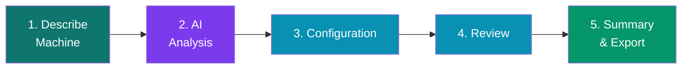
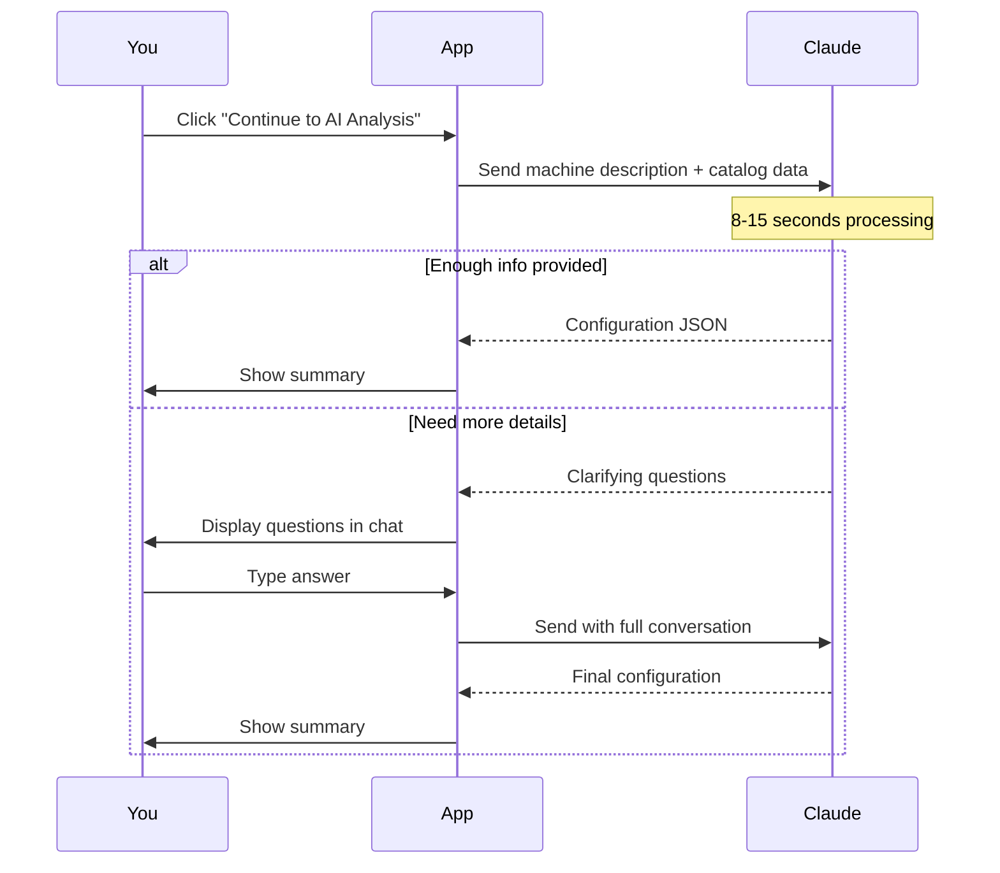
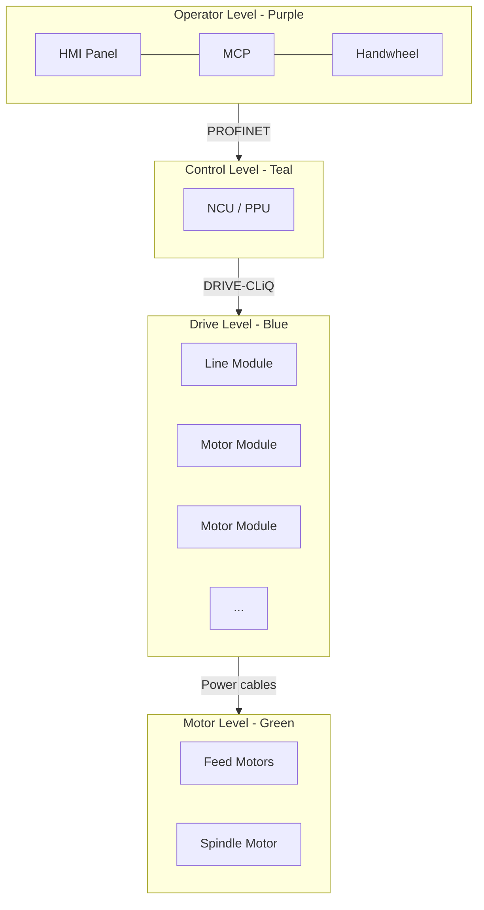

# User Guide

A step-by-step guide to using the SINUMERIK ONE AI Configurator.

## What This App Does

You describe the CNC machine you want to build. The AI picks all the SINUMERIK ONE components you need — control unit, CNC software, drives, motors, safety options, HMI panel, MCP, cables — and produces a complete bill of materials with real Siemens article numbers (MLFBs).

## The 5-Step Workflow



## Step 1: Describe Your Machine

Choose between two input modes:

### Template Mode

Pick from 8 machine types:

| Template | Axes | Typical Use |
|---|---|---|
| 3-Axis Mill | X, Y, Z + Spindle | General milling |
| 5-Axis Center | X, Y, Z, A, C + Spindle | Complex geometry, aerospace |
| CNC Lathe | X, Z + Spindle | Cylindrical parts |
| Mill-Turn | Multi-axis + multi-spindle | Combined turning + milling |
| Grinding | X, Y, Z + Wheel | Surface/cylindrical grinding |
| Laser Cutting | X, Y, Z + Laser | Sheet metal, flat material |
| Punch / Nibble | X, Y + Tool | Sheet metal forming |
| Robot Cell | 6 joint axes | Articulated arm robot |

### Mechanical Specifications Form

After selecting a template, **fill in the mechanical specs** — this is critical for proper motor/drive sizing:

| Field | Example | Why It Matters |
|---|---|---|
| Machine Size | Small / Medium / Large / Very Large | Determines motor shaft height (48 / 63 / 80 / 100+) |
| Axis Travel | 800 × 500 × 500 mm | Affects rapid traverse power needs |
| Moving Mass | 300 kg per axis | Bigger mass → bigger motor torque |
| Rapid Traverse | 30 m/min | Higher speed → more motor power |
| Spindle Power | 15 kW | Determines 1PH8 motor size |
| Spindle Max Speed | 12000 rpm | Selects forced-ventilation or standard motor |
| Material | Aluminum / Steel / Titanium | Cutting force → torque requirements |

> **⚠ If you skip the specs form**, the AI may select undersized motors. A yellow warning appears: "Fill in machine specs for optimal motor/drive sizing".

### Custom Description Mode

Write a free-form description. The AI parses natural language. Example:

> "5-axis gantry milling machine for aerospace parts. X 3000mm Y 2000mm Z 1000mm travel. Gantry moving mass ~2000kg per axis. Spindle 24000rpm 30kW. High surface quality for titanium alloys."

## Step 2: AI Analysis

The app sends your description to Claude (Anthropic API) along with curated SINUMERIK catalog data.

### What happens



### Progress Indicators

While waiting, you see animated status updates:
1. Connecting to AI...
2. Analyzing machine requirements...
3. Selecting control unit...
4. Evaluating drive system options...
5. Matching motors to mechanical requirements...
6. Selecting optimal components...
7. Validating configuration...

### If the AI Asks Questions

Answer in the chat input. Example exchange:

> **AI:** To properly size motors, I need more details:
> 1. What is the required rapid traverse speed for each axis?
> 2. Is this a production or prototype machine?
>
> **You:** 30 m/min rapid. Production machine for aerospace.

Click **Send** or press **Enter**. The AI uses your answers plus the original description.

## Step 3: Configuration

The AI-generated configuration is displayed in collapsible sections:

- **Control Unit** — NCU 1740/1750/1760 or PPU 1740 with specs (max axes, channels, DRIVE-CLiQ ports)
- **CNC Software** — Export or full-scope version + SW version
- **Technology Packages** — S41 (Dynamics Operate), S42 (3-axis), S43 (5-axis), etc.
- **Software Options** — Additional axis licenses, safety (S60/S61), communication options
- **Drive System** — Motor Modules and Line Module with article numbers, rated current/power
- **Motors** — 1FT7 feed motors and 1PH8 spindle with complete MLFBs
- **HMI Components** — Thin Client panel + MCP + handwheel
- **Safety Functions** — Basic (STO/SS1/SBC) + extended if applicable
- **Cables & Accessories** — DRIVE-CLiQ, power cables (sized by motor current), PROFINET, MCP connectors

## Step 4: Review

Verify the complete item list as a table: **#, Component, Article Number, Qty, Category**.

Compatibility warnings appear at the top if any issues were detected:
- Undersized Line Module
- Wrong MCP for panel size
- DRIVE-CLiQ port limit exceeded
- Export version incompatibilities

## Step 5: Summary & Export

The final BOM with three export options:

### Copy to Clipboard

Tab-separated text (paste into Excel, email, ticket):

```text
Pos   MLFB                    Qty   Description
1     6FC5317-5AA00-0AA1      1     NCU 1750
2     6FC5852-1XG25-1YA0      1     CNC SW 6.25 SP1 (full scope)
...
```

### Excel Export

`.xlsx` file with three sheets:
- **BOM** — all line items
- **Summary** — control unit, axes, channels, complexity
- **Notes** — configuration notes from AI

### PDF Export

Printable PDF with header, BOM table, and notes.

### System Diagram

Click **"View System Diagram"** to see a block diagram of the system architecture:



## Live Sidebar

Throughout all steps, the **right sidebar** shows your currently selected components. Click the collapse button to hide it for more workspace.

## Tips for Best Results

### Do:
- ✅ **Fill in the specs form** — machine size, axis travels, moving mass, spindle power
- ✅ **Answer AI clarifying questions precisely** with numbers (torques, speeds, masses)
- ✅ **Specify the workpiece material** — affects cutting forces and motor sizing
- ✅ **Mention special requirements early** — gantry configuration, linear motors, dual-drive axes

### Don't:
- ❌ Use only vague descriptions ("big machine", "heavy duty") — you'll get generic sizing
- ❌ Skip the specs form for production machines
- ❌ Forget to mention safety requirements if you need extended safety (S60 + S61 + SLS/SOS/SLP)

## Troubleshooting

### "AI request timed out after 45 seconds"

The Anthropic API is slow right now. Click retry. If persistent:
- Check your API key is valid in `.env.local`
- Check Anthropic status at [status.anthropic.com](https://status.anthropic.com)
- Try a shorter description

### "Could not extract JSON from AI response"

Claude occasionally produces malformed responses. Click retry. The app tries 3 extraction strategies but some responses still fail.

### The AI selected wrong motors

Verify you filled in the specs form. If yes:
- Go back and add more detail to the description
- Include specific numbers: moving mass, rapid speed, acceleration
- In the Review step, you can manually note discrepancies; future versions will allow direct component swaps

### "No API key set, using mock response"

Your `.env.local` file is missing or the key variable is wrong. It must contain:

```text
ANTHROPIC_API_KEY=sk-ant-api03-...
```

Restart the dev server after editing `.env.local`.

## Keyboard Shortcuts

| Key | Action |
|---|---|
| Enter (in chat input) | Send answer to AI |
| Shift+Enter | New line in chat |
| Esc | Collapse sidebar (not implemented yet) |

## Understanding the BOM Output

Every line in the final BOM has:
- **MLFB** — Siemens article number, e.g., `6SL3120-1TE21-0AD0`
- **Qty** — How many units needed
- **Description** — Human-readable name with order code if applicable
- **Category** — Which component family it belongs to

MLFB structure example — `6SL3120-1TE21-0AD0`:
- `6SL3120` = SINAMICS S120 single Motor Module booksize
- `1TE21` = Rated current code (9A)
- `0AD0` = Cooling type (D = internal air + sensor module adapter)

Copy the MLFB into SiePortal at [sieportal.siemens.com](https://sieportal.siemens.com) to order.
